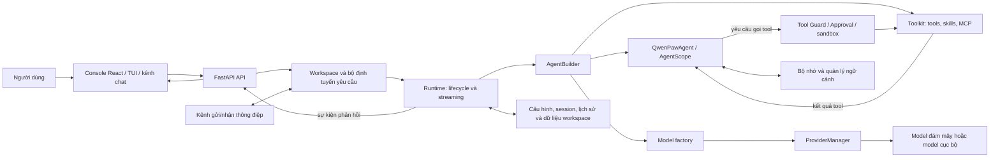

# Tìm hiểu kiến trúc và cơ chế hoạt động của QwenPaw

Tài liệu này giải thích **QwenPaw trong repo hiện tại**: các thành phần chính,
cách một yêu cầu được xử lý, cách tích hợp mô hình ngôn ngữ, các công cụ và
thư viện được sử dụng, cũng như nơi cần đọc mã nguồn để hiểu sâu hơn.

Đây là tài liệu đọc hiểu hệ thống, không phải thiết kế cho một sản phẩm mới.
Các tính năng và chi tiết bên dưới được đối chiếu với mã nguồn có trong repo.
QwenPaw phát triển liên tục, vì vậy cấu trúc hoặc phiên bản có thể thay đổi
giữa các commit.

## 1. QwenPaw là gì?

QwenPaw là một ứng dụng trợ lý AI cá nhân. Đây **không phải bản thân một mô
hình AI**. Ứng dụng cung cấp giao diện, máy chủ, runtime agent, cấu hình nhà
cung cấp model, lịch sử hội thoại, công cụ, skills, bộ nhớ, kênh giao tiếp và
các lớp an toàn. Khi cần sinh nội dung, ứng dụng kết nối tới một model đã cấu
hình — có thể ở dịch vụ đám mây hoặc chạy cục bộ.

Có thể tách hệ thống thành ba lớp khái niệm:

1. **Ứng dụng**: Console, API, cấu hình, lịch sử và các kênh như Telegram,
   Discord hoặc DingTalk.
2. **Điều phối agent**: ghép model, prompt, ngữ cảnh và tập công cụ; điều
   khiển vòng lặp suy luận và gọi công cụ.
3. **Model và tích hợp**: model sinh văn bản, các dịch vụ bên ngoài, MCP,
   skills, bộ nhớ, trình duyệt và những công cụ khác.

Repo hiện tại dùng Python cho backend/runtime và TypeScript/React cho Console.
Mã backend chính nằm trong [`src/qwenpaw/`](src/qwenpaw/), giao diện web nằm
trong [`console/src/`](console/src/).

## 2. Sơ đồ kiến trúc tổng quát



Sơ đồ là bản tóm tắt để dễ đọc, không phải biểu đồ mô tả mọi lớp hoặc mọi
đường đi trong chương trình. Ví dụ, mỗi channel có cách nhận/gửi thông điệp
riêng nhưng được chuẩn hóa về các kiểu yêu cầu chung.

## 3. Công nghệ và công cụ được sử dụng

### Thành phần chạy ứng dụng

| Thành phần | Vai trò | Nơi xem trong repo |
|---|---|---|
| **Python 3.11 đến dưới 3.14** | Backend, API, runtime, tích hợp provider và công cụ | [`pyproject.toml`](pyproject.toml) |
| **FastAPI và Uvicorn** | Cung cấp HTTP API và chạy máy chủ ứng dụng | [`src/qwenpaw/app/_app.py`](src/qwenpaw/app/_app.py), [`src/qwenpaw/cli/app_cmd.py`](src/qwenpaw/cli/app_cmd.py) |
| **AgentScope 2.0.9** | Nền tảng agent/model/message/tool mà QwenPaw mở rộng | [`pyproject.toml`](pyproject.toml), [`src/qwenpaw/agents/react_agent.py`](src/qwenpaw/agents/react_agent.py) |
| **OpenAI Python SDK** | Giao tiếp với OpenAI và các endpoint tương thích giao thức OpenAI | [`src/qwenpaw/providers/openai_provider.py`](src/qwenpaw/providers/openai_provider.py) |
| **Các provider chuyên biệt** | Tích hợp các giao thức/nhà cung cấp khác nhau | [`src/qwenpaw/providers/`](src/qwenpaw/providers/) |
| **ReMe** | Backend bộ nhớ AI được QwenPaw tích hợp | [`src/qwenpaw/agents/memory/reme_light_memory_manager.py`](src/qwenpaw/agents/memory/reme_light_memory_manager.py) |
| **APScheduler** | Hỗ trợ tính năng tác vụ theo lịch | [`pyproject.toml`](pyproject.toml), [`src/qwenpaw/app/crons/`](src/qwenpaw/app/crons/) |

### Giao diện và đóng gói

| Công cụ | Vai trò | Nơi xem trong repo |
|---|---|---|
| **React + TypeScript** | Giao diện Console | [`console/src/`](console/src/), [`console/package.json`](console/package.json) |
| **Vite** | Chạy dev server và build frontend | [`console/package.json`](console/package.json), [`console/vite.config.ts`](console/vite.config.ts) |
| **Tauri** | Đóng gói ứng dụng desktop | [`console/src-tauri/`](console/src-tauri/) |
| **Docker** | Đóng gói ứng dụng và các phụ thuộc thành container | [`deploy/Dockerfile`](deploy/Dockerfile), [`docker-compose.yml`](docker-compose.yml) |

### Công cụ phát triển và kiểm thử

- **pytest**, `pytest-asyncio`, `pytest-cov`: test Python; cấu hình và các nhóm
  test nằm trong [`pyproject.toml`](pyproject.toml) và [`tests/`](tests/).
- **Vitest** và React Testing Library: test frontend; các lệnh nằm trong
  [`console/package.json`](console/package.json).
- **Playwright**: được dùng cho một số luồng kiểm thử trình duyệt và chức năng
  trình duyệt của ứng dụng.
- **ESLint**, **TypeScript** và **Prettier**: kiểm tra hoặc định dạng mã
  frontend, theo scripts trong [`console/package.json`](console/package.json).
- **Docker multi-stage build**: bước build Console bằng Node được tách khỏi
  bước đóng gói runtime; xem [`deploy/Dockerfile`](deploy/Dockerfile).

Không phải mọi package trong `pyproject.toml` đều được gọi trong một lượt chat.
Danh sách dependencies bao gồm các tính năng tùy chọn, channel, công cụ, model
cục bộ và các phần mở rộng khác nhau.

## 4. Một lượt chat đi qua hệ thống như thế nào?

Luồng Console là cách dễ nhất để lần theo mã nguồn:

1. **Người dùng gửi nội dung từ Console.** Frontend gọi
   `POST /api/console/chat`; hàm client nằm trong
   [`console/src/api/modules/agent.ts`](console/src/api/modules/agent.ts).
2. **FastAPI tiếp nhận yêu cầu.** Router ở
   [`src/qwenpaw/app/routers/console.py`](src/qwenpaw/app/routers/console.py)
   chuẩn hóa payload, xác định workspace/agent, session và lịch sử chat.
3. **Yêu cầu được chạy như một tác vụ có thể stream.** Router trả về
   `text/event-stream` (SSE), để giao diện nhận sự kiện trong khi agent đang
   thực hiện. Task tracker cho phép theo dõi tác vụ và hỗ trợ kết nối lại với
   một stream đang chạy.
4. **Runtime điều phối vòng đời yêu cầu.** Trong
   [`src/qwenpaw/runtime/runtime.py`](src/qwenpaw/runtime/runtime.py),
   runtime chuẩn hóa yêu cầu, tạo context và lần lượt chạy các hook ở những
   giai đoạn như trước khi dispatch, trước/sau khi dựng agent, trước khi chạy,
   sau phản hồi và khi có lỗi.
5. **AgentBuilder tập hợp agent cho lượt đó.** Trong
   [`src/qwenpaw/runtime/builder.py`](src/qwenpaw/runtime/builder.py),
   builder lấy cấu hình agent, model, system prompt, toolkit, middleware,
   ngữ cảnh và chính sách liên quan rồi truyền chúng vào agent. Agent được
   dựng theo yêu cầu; không phải model tự tạo toàn bộ ứng dụng.
6. **Model factory chọn model.** Factory đọc model slot đang hoạt động hoặc
   override của agent/session, tìm provider tương ứng trong `ProviderManager`,
   tạo model và formatter, rồi có thể bọc model bằng lớp ghi nhận token,
   retry, rate-limit và fallback. Điểm vào là
   [`create_model_and_formatter`](src/qwenpaw/agents/model_factory.py);
   định nghĩa provider nằm trong [`src/qwenpaw/providers/`](src/qwenpaw/providers/).
7. **Agent bắt đầu vòng lặp trả lời.** `QwenPawAgent` kế thừa khả năng agent
   của AgentScope và bổ sung các phần của QwenPaw như tool guard, quản lý
   ngữ cảnh, skills và Coding Mode. Phần lớp agent nằm trong
   [`src/qwenpaw/agents/react_agent.py`](src/qwenpaw/agents/react_agent.py).
8. **Agent gửi đầu vào tới model.** Model nhận các thông điệp hội thoại đã
   định dạng, prompt hệ thống, các công cụ được phép đưa vào yêu cầu và các
   tham số theo provider/model. Model sinh nội dung hoặc trả về yêu cầu gọi
   một công cụ.
9. **Nếu model yêu cầu dùng công cụ, agent thực hiện vòng lặp ReAct.** Agent
   có thể gọi tool, đưa kết quả tool trở lại hội thoại, rồi gọi model thêm lần
   nữa. Vì vậy một câu trả lời có dùng tool có thể gồm nhiều lượt trao đổi với
   model, không chỉ một API call.
10. **Tool được kiểm tra trước khi chạy.** Các tool có thể bị giới hạn theo
    agent, mode, skill, feature, quyền, sandbox hoặc chính sách xác nhận.
    Nếu cần chấp thuận, lượt chạy có thể chờ người dùng. Các lớp liên quan
    gồm [`src/qwenpaw/runtime/tool_registry.py`](src/qwenpaw/runtime/tool_registry.py),
    [`src/qwenpaw/runtime/tool_guard.py`](src/qwenpaw/runtime/tool_guard.py)
    và [`src/qwenpaw/security/tool_guard/`](src/qwenpaw/security/tool_guard/).
11. **Kết quả được phát dần về frontend.** `AgentExecutor` đọc
    `agent.reply_stream(...)`, còn `Envelope` chuyển các sự kiện agent thành
    định dạng stream của QwenPaw. Xem
    [`src/qwenpaw/runtime/executor.py`](src/qwenpaw/runtime/executor.py),
    [`src/qwenpaw/runtime/envelope.py`](src/qwenpaw/runtime/envelope.py).
12. **Ứng dụng hoàn tất lượt và lưu trạng thái.** Session/hội thoại và các dữ
    liệu liên quan được quản lý bởi workspace cùng các repository tương ứng.
    Khi cần, runtime có thể lưu trạng thái để phục hồi sau gián đoạn.

Luồng tổng quát:

```text
UI -> HTTP API -> Workspace -> Runtime -> AgentBuilder
   -> AgentScope agent -> Model provider -> LLM
                         ^                  |
                         | tool result      | tool call (nếu cần)
                         +-- Tool Guard <- Toolkit
   <- SSE events <- AgentExecutor <- agent stream
```

Không phải mọi loại channel đều gọi cùng endpoint Console. Tuy nhiên, các
channel được chuẩn hóa về yêu cầu và sự kiện agent chung; điểm vào Console
`POST /api/console/chat` chỉ là một ví dụ cụ thể, không phải toàn bộ API của
hệ thống.

## 5. Cơ chế agent và gọi công cụ

### Agent không chỉ là một lời gọi chat completion

Một chatbot đơn giản thường gửi `system + user message` một lần tới model rồi
hiển thị kết quả. QwenPaw dùng mô hình **agent có công cụ**:

- **Model** tạo văn bản, hoặc tạo yêu cầu gọi tool theo schema.
- **Agent** duy trì trạng thái hội thoại, quyết định cách xử lý các sự kiện
  model/tool và tiếp tục vòng lặp.
- **Tool** là hàm thực thi thật, chẳng hạn thao tác tệp, shell, trình duyệt,
  MCP hoặc các chức năng nội bộ.
- **Runtime** quản lý vòng đời, hook, streaming và lỗi của cả lượt.

Các tool không phải do model tự thực thi. Model chỉ đề nghị một tool cùng các
tham số; ứng dụng kiểm tra quyền rồi mới gọi hàm thật. Kết quả trả về được
đưa lại vào ngữ cảnh để model tiếp tục xử lý.

### Tool, Skill, Plugin và MCP khác nhau thế nào?

| Khái niệm | Ý nghĩa trong QwenPaw |
|---|---|
| **Tool** | Một thao tác mà agent có thể gọi; thường có tên, mô tả và schema tham số. |
| **Skill** | Hướng dẫn theo tác vụ, thường ở file `SKILL.md`; cung cấp tri thức hoặc quy trình để agent biết cách dùng công cụ. Skill tự nó không nhất thiết là hàm thực thi. |
| **Plugin** | Cơ chế mở rộng có thể đăng ký thành phần chạy, tool, mode hoặc tích hợp bổ sung. |
| **MCP** | Giao thức để kết nối tới server công cụ/nguồn dữ liệu bên ngoài. Các công cụ MCP được đưa vào toolkit theo cấu hình và chính sách. |

Tool có thể được chọn theo mode/skill/feature của yêu cầu. Tool đăng ký và bộ lọc
được mô tả trong [`src/qwenpaw/runtime/tool_registry.py`](src/qwenpaw/runtime/tool_registry.py);
hệ thống skills nằm trong [`src/qwenpaw/agents/skill_system/`](src/qwenpaw/agents/skill_system/);
API và tích hợp plugin/MCP nằm trong [`src/qwenpaw/app/routers/`](src/qwenpaw/app/routers/).

### An toàn khi gọi tool

QwenPaw có các lớp kiểm soát trước khi tool chạy. Tùy cấu hình và loại tool,
hệ thống có thể cho phép, từ chối hoặc yêu cầu người dùng xác nhận. Các công
cụ truy cập tệp, shell hoặc tài nguyên có thể cần cơ chế bảo vệ bổ sung.
Skill Scanner dùng để quét skill; Tool Guard dùng để đánh giá tool call; luồng
approval xử lý thao tác cần người dùng chấp thuận.

Đây là lớp bảo vệ trong ứng dụng, **không nên hiểu là bảo đảm tuyệt đối rằng
mọi tool hoặc mọi nội dung model đều an toàn**. Khi triển khai thật, cần đọc
chính sách cụ thể, cấu hình sandbox, auth, quyền filesystem và network.

## 6. Tích hợp model ngôn ngữ (LLM)

### 6.1 Model do provider cung cấp

Model thường là dịch vụ riêng hoặc runtime local. QwenPaw lưu cấu hình provider
và model đã chọn; ứng dụng sử dụng lớp provider để tạo model thống nhất cho
agent. Một số provider có API/giao thức tương thích OpenAI; provider khác cần
lớp tích hợp riêng.

Các ví dụ provider có trong repo gồm OpenAI, Anthropic, Gemini, DashScope,
OpenRouter, Ollama, LM Studio và các dịch vụ/model khác. Danh mục và cách kết
nối cụ thể có thể thay đổi theo cấu hình/bản build. Mã tích hợp nằm dưới
[`src/qwenpaw/providers/`](src/qwenpaw/providers/); danh sách dependency trong
[`pyproject.toml`](pyproject.toml) cho thấy một số SDK được cài cùng ứng dụng.

QwenPaw cũng hỗ trợ các lựa chọn model local được mô tả trong
[`README_vi.md`](README_vi.md), gồm QwenPaw Local, Ollama và LM Studio. Với
model local, quá trình sinh có thể diễn ra trên máy người dùng; với provider
cloud, yêu cầu model được gửi qua mạng tới nhà cung cấp.

### 6.2 Các lớp của đường gọi model

```text
AgentBuilder
   -> create_model_and_formatter()
      -> lấy cấu hình agent/session
      -> xác định model slot và provider
      -> provider tạo ChatModel
      -> gắn formatter đúng giao thức
      -> wrapper ghi nhận token / retry / rate limit / fallback
   -> QwenPawAgent gọi model trong vòng lặp agent
```

Model factory không phải model mới được huấn luyện bên trong QwenPaw. Nó là
lớp **chọn, cấu hình và bọc model client** để agent có giao diện gọi thống
nhất. Xem [`src/qwenpaw/agents/model_factory.py`](src/qwenpaw/agents/model_factory.py)
và [`src/qwenpaw/providers/provider.py`](src/qwenpaw/providers/provider.py).

### 6.3 Prompt, formatter và message

- **System prompt** quy định vai trò, cách làm việc và hướng dẫn chung cho
  agent. Prompt có thể được xây từ cấu hình và các thành phần tương ứng; xem
  [`src/qwenpaw/agents/prompt_builder.py`](src/qwenpaw/agents/prompt_builder.py)
  và [`src/qwenpaw/runtime/prompt_manager.py`](src/qwenpaw/runtime/prompt_manager.py).
- **Message formatter** chuyển thông điệp và tool schema sang định dạng mà
  provider cụ thể mong đợi. Mỗi giao thức có thể khác về vai trò message,
  tool call, media, reasoning hoặc giới hạn token.
- **Model** tạo phản hồi dựa trên đầu vào đã gửi. Model không tự biết tệp,
  session hay cấu hình của ứng dụng nếu những dữ liệu đó chưa được đưa vào
  yêu cầu hoặc được truy xuất bằng tool.

### 6.4 API key và dữ liệu

- API key là thông tin bí mật: không commit key vào repo, không gửi key từ
  frontend tới model như nội dung chat và không ghi key vào log.
- Cấu hình provider được quản lý ở backend; thư mục bí mật mặc định được xác
  định qua `QWENPAW_SECRET_DIR` hoặc vùng cạnh working directory. Xem
  [`src/qwenpaw/constant.py`](src/qwenpaw/constant.py) và
  [`src/qwenpaw/providers/provider_manager.py`](src/qwenpaw/providers/provider_manager.py).
- Khi dùng provider cloud, cần giả định prompt/ngữ cảnh đã gửi sẽ được nhà
  cung cấp xử lý theo điều khoản dịch vụ của họ. Dùng model local không đồng
  nghĩa toàn bộ chức năng ứng dụng không truy cập mạng; channel, MCP, trình
  duyệt, telemetry hoặc tính năng khác có thể vẫn dùng mạng theo cấu hình.

## 7. Hội thoại, bộ nhớ và giới hạn ngữ cảnh

Ba khái niệm này có liên quan nhưng không đồng nhất:

1. **Session/hội thoại**: danh tính chat, lịch sử lượt chat và trạng thái agent.
   Ví dụ, metadata các chat Console được quản lý qua
   [`src/qwenpaw/app/chats/`](src/qwenpaw/app/chats/), trong đó có repository
   JSON tại [`src/qwenpaw/app/chats/repo/json_repo.py`](src/qwenpaw/app/chats/repo/json_repo.py).
2. **Ngữ cảnh gửi cho model**: tập message, kết quả tool, hướng dẫn và dữ liệu
   liên quan hiện được giữ/chuẩn bị cho lượt gọi model. Context manager có thể
   nén hoặc quản lý lịch sử để xử lý giới hạn context; xem
   [`src/qwenpaw/agents/context/`](src/qwenpaw/agents/context/).
3. **Bộ nhớ dài hạn/tri thức**: QwenPaw có backend bộ nhớ dựa trên ReMe và
   khả năng tìm kiếm/tái sử dụng thông tin đã lưu. Xem
   [`src/qwenpaw/agents/memory/`](src/qwenpaw/agents/memory/) và
   [`src/qwenpaw/agents/memory/reme_light_memory_manager.py`](src/qwenpaw/agents/memory/reme_light_memory_manager.py).

Không nên mặc định rằng toàn bộ lịch sử cũ luôn được gửi nguyên vẹn tới model.
Ứng dụng có thể cắt gọn, nén, truy xuất hoặc chỉ đưa một phần ngữ cảnh vào
request, tùy chiến lược được cấu hình và giới hạn của model.

## 8. Channel, lịch và các chức năng ngoài chat

### Channel

Channel là adapter nhận thông điệp từ một nơi và gửi phản hồi trở lại nơi đó.
Repo có Console và nhiều tích hợp nhắn tin; ví dụ
[`src/qwenpaw/app/channels/console/channel.py`](src/qwenpaw/app/channels/console/channel.py)
cho thấy Console channel xử lý đầu ra, còn API Console tiếp nhận chat.
Các channel thường dùng kiểu `AgentRequest`/event chung để kết nối với agent.

### Tác vụ định kỳ

Cron là chức năng của backend tách biệt với việc model tự “đặt giờ”. Job được
lưu và chạy theo lịch bởi dịch vụ quản lý/executor; khi đến lượt, job có thể
khởi tạo tác vụ agent và sau đó gửi kết quả qua channel. Có thể lần theo
[`src/qwenpaw/app/crons/`](src/qwenpaw/app/crons/) và
[`src/qwenpaw/cli/cron_cmd.py`](src/qwenpaw/cli/cron_cmd.py).

Nói cách khác: model có thể giúp diễn giải hoặc thực hiện nội dung job, còn
đồng hồ, lưu lịch, trigger và gửi thông điệp là trách nhiệm của ứng dụng và
các tích hợp tương ứng.

## 9. Khởi động và lưu trữ dữ liệu

### Khởi động server

Lệnh `qwenpaw app` được định nghĩa ở
[`src/qwenpaw/cli/app_cmd.py`](src/qwenpaw/cli/app_cmd.py) và chạy ứng dụng
FastAPI bằng Uvicorn. Ứng dụng FastAPI và lifespan nằm trong
[`src/qwenpaw/app/_app.py`](src/qwenpaw/app/_app.py). Trong startup, app
chuẩn bị các manager/workspace, provider, cấu hình và các dịch vụ nền cần
thiết; trong shutdown, nó giải phóng tài nguyên tương ứng.

Mặc định server gắn vào `127.0.0.1:8088`; xem tùy chọn của lệnh `app`. Nếu
đổi sang địa chỉ có thể truy cập từ mạng, cần bật authentication hoặc giới
hạn mạng truy cập phù hợp.

### Các vị trí dữ liệu quan trọng

- `QWENPAW_WORKING_DIR`: thư mục dữ liệu làm việc; mặc định là
  `~/.qwenpaw`, nhưng cài đặt cũ `~/.copaw` có thể được dùng để tương thích.
- `QWENPAW_SECRET_DIR`: nơi lưu dữ liệu nhạy cảm/cấu hình provider; mặc định
  là thư mục working kèm hậu tố `.secret`.
- Metadata chat và job có các repository JSON; ví dụ
  [`src/qwenpaw/app/chats/repo/json_repo.py`](src/qwenpaw/app/chats/repo/json_repo.py)
  và [`src/qwenpaw/app/crons/repo/json_repo.py`](src/qwenpaw/app/crons/repo/json_repo.py).
- Không nên kết luận toàn bộ dữ liệu chỉ được lưu trong một tệp hay một loại
  database. Từng subsystem có thể có backend và định dạng riêng; xem
  [`src/qwenpaw/constant.py`](src/qwenpaw/constant.py) và thư mục subsystem
  tương ứng để biết chính xác.

## 10. Bố cục repo nên biết

| Đường dẫn | Nội dung chính |
|---|---|
| [`src/qwenpaw/cli/`](src/qwenpaw/cli/) | Các lệnh CLI như `app`, `init`, `doctor`, `cron` và quản lý provider. |
| [`src/qwenpaw/app/_app.py`](src/qwenpaw/app/_app.py) | Tạo FastAPI app, lifespan, đăng ký router và phục vụ giao diện. |
| [`src/qwenpaw/app/routers/`](src/qwenpaw/app/routers/) | Các HTTP API: Console, agent, provider, config, chat, cron, file, MCP, plugin, v.v. |
| [`src/qwenpaw/app/channels/`](src/qwenpaw/app/channels/) | Adapter cho Console và các channel nhắn tin. |
| [`src/qwenpaw/runtime/`](src/qwenpaw/runtime/) | Điều phối lifecycle yêu cầu: Runtime, AgentBuilder, executor, hooks, tool guard. |
| [`src/qwenpaw/agents/react_agent.py`](src/qwenpaw/agents/react_agent.py) | Agent chính QwenPaw mở rộng từ nền tảng AgentScope. |
| [`src/qwenpaw/agents/model_factory.py`](src/qwenpaw/agents/model_factory.py) | Chọn và khởi tạo model/formatter theo cấu hình. |
| [`src/qwenpaw/providers/`](src/qwenpaw/providers/) | Provider, model catalog, cấu hình và adapter giao thức. |
| [`src/qwenpaw/agents/tools/`](src/qwenpaw/agents/tools/) | Các tool có thể cung cấp cho agent. |
| [`src/qwenpaw/agents/skill_system/`](src/qwenpaw/agents/skill_system/) và [`src/qwenpaw/agents/skills/`](src/qwenpaw/agents/skills/) | Runtime quản lý skills và các skill đi kèm. |
| [`src/qwenpaw/agents/memory/`](src/qwenpaw/agents/memory/) | Tích hợp backend bộ nhớ. |
| [`src/qwenpaw/security/`](src/qwenpaw/security/) | Tool Guard, Skill Scanner, secrets và các lớp liên quan. |
| [`src/qwenpaw/config/`](src/qwenpaw/config/) | Schema, đọc/ghi và chuẩn hóa cấu hình. |
| [`console/src/`](console/src/) | Giao diện React/TypeScript, API client, feature và store. |
| [`console/src-tauri/`](console/src-tauri/) | Cấu hình/mã nguồn cho desktop app Tauri. |
| [`tests/`](tests/) | Python unit, integration, contract và e2e tests. |
| [`console/src/`](console/src/) | Frontend và các test Vitest đặt cạnh mã nguồn. |
| [`deploy/`](deploy/) và [`scripts/`](scripts/) | Docker, build, phát hành và tiện ích vận hành. |

## 11. Lệnh dựng và chạy bản source trên Windows

Repo có hướng dẫn cài đặt chi tiết trong
[`HUONG_DAN_CAI_DAT_QWENPAW.md`](HUONG_DAN_CAI_DAT_QWENPAW.md). Luồng cơ bản
theo tài liệu của repo:

1. Cài Python trong dải phiên bản được khai báo ở `pyproject.toml`, Node.js
   theo yêu cầu frontend, npm và Git.
2. Tạo môi trường ảo Python, cài dependencies.
3. Trong `console`, cài package theo lockfile và build frontend.
4. Đưa kết quả build vào package Python theo workflow source của repo.
5. Cài package ở chế độ editable, chạy init, rồi khởi động `qwenpaw app`.
6. Mở Console trên địa chỉ loopback và cấu hình model/provider.

Một phiên bản PowerShell tối giản:

```powershell
git clone https://github.com/agentscope-ai/QwenPaw.git
Set-Location QwenPaw

python -m venv .venv
.\.venv\Scripts\Activate.ps1

Set-Location console
npm ci
npm run build
Set-Location ..

New-Item -ItemType Directory -Force -Path .\src\qwenpaw\console | Out-Null
Copy-Item -Recurse -Force .\console\dist\* .\src\qwenpaw\console\

python -m pip install -e ".[dev,test]"
qwenpaw init --defaults
qwenpaw app --host 127.0.0.1 --port 8088
```

Các biến môi trường/tuỳ chọn cho model và provider phụ thuộc nhà cung cấp.
Không dán API key thật vào README, ví dụ công khai, commit hoặc lịch sử Git.
Tham khảo `Settings → Models` trong Console và
[`README_vi.md`](README_vi.md) để biết hướng dẫn cấu hình model theo bản repo.

## 12. Cách đọc mã nguồn để hiểu hệ thống

Nên đọc theo thứ tự sau để tránh bắt đầu từ những subsystem quá lớn:

1. **Lệnh chạy server**:
   [`src/qwenpaw/cli/app_cmd.py`](src/qwenpaw/cli/app_cmd.py)
   → [`src/qwenpaw/app/_app.py`](src/qwenpaw/app/_app.py).
2. **API nhận chat**:
   [`console/src/api/modules/agent.ts`](console/src/api/modules/agent.ts)
   → [`src/qwenpaw/app/routers/console.py`](src/qwenpaw/app/routers/console.py).
3. **Runtime orchestration**:
   [`src/qwenpaw/runtime/runtime.py`](src/qwenpaw/runtime/runtime.py)
   → [`src/qwenpaw/runtime/builder.py`](src/qwenpaw/runtime/builder.py)
   → [`src/qwenpaw/runtime/executor.py`](src/qwenpaw/runtime/executor.py).
4. **Agent và provider**:
   [`src/qwenpaw/agents/react_agent.py`](src/qwenpaw/agents/react_agent.py)
   → [`src/qwenpaw/agents/model_factory.py`](src/qwenpaw/agents/model_factory.py)
   → [`src/qwenpaw/providers/provider.py`](src/qwenpaw/providers/provider.py)
   → provider cụ thể như
   [`src/qwenpaw/providers/openai_provider.py`](src/qwenpaw/providers/openai_provider.py).
5. **Tool và quyền**:
   [`src/qwenpaw/runtime/tool_registry.py`](src/qwenpaw/runtime/tool_registry.py)
   → [`src/qwenpaw/runtime/tool_guard.py`](src/qwenpaw/runtime/tool_guard.py)
   → [`src/qwenpaw/security/tool_guard/`](src/qwenpaw/security/tool_guard/).
6. **Lịch sử, memory và cron**:
   [`src/qwenpaw/app/chats/`](src/qwenpaw/app/chats/)
   → [`src/qwenpaw/agents/context/`](src/qwenpaw/agents/context/)
   → [`src/qwenpaw/agents/memory/`](src/qwenpaw/agents/memory/)
   → [`src/qwenpaw/app/crons/`](src/qwenpaw/app/crons/).

Khi lần theo một symbol, bắt đầu ở route hoặc API client, sau đó lần theo hàm
được gọi trực tiếp. Không nên đọc toàn bộ repo một lượt: repo lớn, có nhiều
adapter theo provider/channel và nhiều tính năng độc lập.

## 13. Những điều dễ hiểu nhầm

- **QwenPaw không phải model và cũng không nhất thiết tự huấn luyện model.**
  Phần lớn đường gọi model là tích hợp client/provider với model đã được cấu
  hình.
- **Gọi được model chưa đồng nghĩa có một agent đầy đủ.** Agent còn cần
  messages, prompt, trạng thái, lựa chọn tools và quy tắc thực thi.
- **Model không trực tiếp chạy lệnh máy tính.** Nó yêu cầu tool; code ứng
  dụng mới thực thi, sau khi các chính sách và kiểm tra áp dụng.
- **Tool không đồng nghĩa skill.** Tool là thao tác được chạy; skill thường
  là hướng dẫn để agent biết cách giải quyết một loại việc.
- **SSE chỉ là cách truyền sự kiện/phản hồi dần.** Nó không tạo ra chất lượng
  suy luận của model.
- **Có model local không có nghĩa mọi hoạt động đều offline.** Các tích hợp
  khác trong ứng dụng vẫn có thể truy cập mạng tùy chức năng và cấu hình.
- **README cài đặt mô tả cách khởi chạy, không thay thế sơ đồ kiến trúc.**
  Dùng phần “Cách đọc mã nguồn” để hiểu luồng thực thi trong code.

## 14. Tóm tắt

QwenPaw hiện tại có thể hiểu như sau:

> Giao diện hoặc channel gửi một yêu cầu vào backend. Runtime chọn workspace
> và dựng agent cho yêu cầu đó bằng cách ghép prompt, model, ngữ cảnh và bộ
> công cụ. Agent gọi model; nếu model yêu cầu công cụ, ứng dụng kiểm tra quyền
> rồi thực thi và gửi kết quả lại cho model. Runtime chuyển các sự kiện phản
> hồi thành stream cho giao diện, đồng thời quản lý trạng thái và dữ liệu của
> session.

Đây là nền tảng để tiếp tục khảo sát từng module. Khi muốn thay đổi hệ thống,
hãy xác định trước luồng chức năng liên quan, các API/contracts của nó, cấu
hình lưu ở đâu, công cụ nào có quyền chạy, và test nào mô tả hành vi hiện tại.
